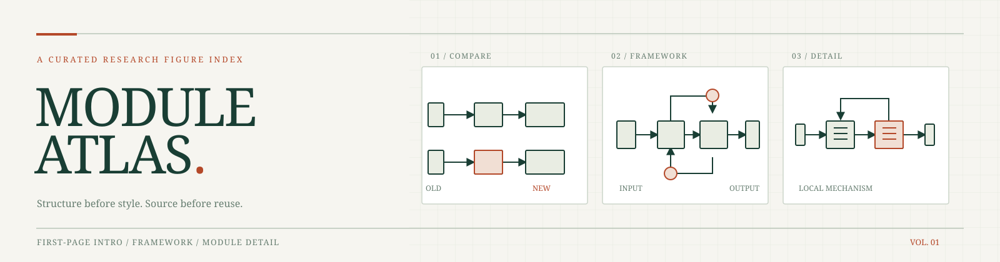

# Module Atlas



**A provenance-first index of computer-vision and generative-model diagrams.**
首页引导图、整体框架与模块细节的可追溯图谱，不是无来源的“免费素材包”。

`1,131 indexed diagrams` · `1,008 in the last 12 months` · `26 first-page intro diagrams`

> **Snapshot: 11 November 2026.** The recent window is **11 November 2025–11 November 2026**, inclusive. The curated [recent-1000 catalog](catalog/recent-1000.json) contains exactly 1,000 visually reviewed entries, including 561 journal entries. Counts describe indexed diagrams, not images licensed for public redistribution.

## Explore

| Collection | Indexed | What to look for |
| --- | ---: | --- |
| [First-page Intro](docs/taxonomy.md#first-page-intro) | 26 | Compact visual openings on a paper's first page |
| [Concept & comparison](docs/taxonomy.md#concept--comparison) | 199 | Before/after, motivation, and structural contrast |
| [Frameworks](docs/taxonomy.md#frameworks) | 619 | Inputs, branches, backbone, outputs, and training flows |
| [Module details](docs/taxonomy.md#module-details) | 287 | Attention, fusion, conditioning, and local mechanisms |

The [catalog](catalog/recent-1000.json) links each entry to its paper, venue, figure number, and (where available) page and crop coordinates. The archive was assembled from official proceedings and publisher or author sources; every included crop passed a diagram-only visual check. See [selection and provenance](docs/provenance.md).

The [`site/`](site/) directory is a metadata-only gallery with the same editorial visual language as the private full-image atlas. To publish it through GitHub Pages, set **Settings → Pages → Build and deployment → GitHub Actions** after creating the repository; the included workflow uploads only `site/` and contains no third-party images.

## Local gallery

The public repository intentionally contains **no third-party figure files or thumbnails**. If you have access to a local collection of the corresponding PNGs, you can build the gallery on your own computer:

```bash
python3 -m pip install -r requirements.txt
python3 tools/build_local_gallery.py --images /path/to/extracted-PNG-folder --output /path/to/module-atlas-gallery
cd /path/to/module-atlas-gallery && python3 -m http.server 8000
```

Open `http://localhost:8000`. The gallery scans the image folder recursively for files named `<figure-id>.png`, generates lightweight thumbnails, and links each card back to the original paper. Missing images remain source-linked catalog entries; the script does not fetch or rehost papers.

To validate the public index without images:

```bash
python3 tools/validate_catalog.py
```

## How to use a diagram responsibly

1. Follow the paper link in the catalog and verify the source and figure number.
2. Treat a diagram as visual inspiration or scholarly reference, not as an asset with a blanket reuse license.
3. Before reposting a crop, thumbnail, or adaptation, verify **that specific figure's** license or obtain permission. Credit the authors, source, license, and any crop or format change.

Open access to a paper does **not** automatically grant permission to redistribute its figures. [Rights and licensing](RIGHTS.md) explains why code and catalog metadata can be public while the image archive remains private.

## Contribute

New entries should include a stable paper URL, venue, publication date evidence, figure number, diagram role, and a clean crop reviewed at full size. Never add third-party image binaries without a recorded redistribution basis. See [CONTRIBUTING.md](CONTRIBUTING.md) and the [crop standard](docs/crop-standard.md).

## License

Repository code and original project artwork: [MIT](LICENSE). Catalog metadata: [CC0 1.0](DATA_LICENSE.md). **Neither license covers third-party paper figures.**
